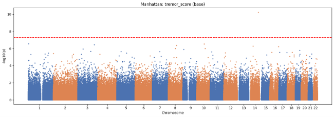

# parkinsons-gwas-analysis

Genome-wide association analyses of cognitive impairment, tremor severity, and Parkinson's disease risk using Hail.

## Overview

This repository contains genome-wide association study (GWAS) workflows developed for investigating the genetic architecture of Parkinson's disease, with a focus on:

- Tremor severity
- Cognitive impairment
- Parkinson's disease susceptibility

The workflow performs discovery GWAS, model comparison, cross-trait validation, independent locus definition, and post-GWAS characterization.

## Scientific Objectives

1. Identify variants associated with tremor severity and cognitive impairment in Parkinson's disease.
2. Distinguish motor-specific, cognitive-specific, and shared genetic effects.
3. Quantify genomic inflation and model performance.
4. Compare Parkinson's disease cognitive impairment signals with cognitive impairment and Parkinson's disease risk in a large case-control dataset.
5. Evaluate overlap between cognitive impairment biology and Parkinson's disease risk.
6. Generate summary statistics suitable for downstream analyses including:
   - Polygenic Risk Scores (PRS)
   - LD Score Regression (LDSC)
   - Locus-level analyses
   - Cross-trait genetic comparisons

## Methods

- Hail-based GWAS workflows
- Linear regression GWAS
- Logistic regression GWAS
- Population structure correction using principal components
- Covariate-adjusted phenotype modeling
- Genome-wide significance testing
- Manhattan plots
- QQ plots
- Genomic inflation calculations (λGC)
- Independent locus definition (distance-based, ±500 kb)
- Cross-trait locus overlap analyses
- Effect-size correlation and directional concordance analyses
- Summary statistic harmonization

## Phenotypes

### Parkinson's Disease Cohort

- tremor_score
- ci_unique_count
- ci_binary

### Case-Control Cohort

- Cognitive impairment
- Parkinson's disease risk

## Outputs

- GWAS summary statistics
- Manhattan plots
- QQ plots
- Model diagnostics
- High-confidence variant reports
- Independent locus tables
- Locus overlap analyses
- Effect-size correlation analyses
- Validation reports

## Software

Key packages used in this workflow include:

- Hail
- pandas
- NumPy
- SciPy
- matplotlib
- seaborn
- matplotlib-venn
- gcsfs

Exporting compressed summary statistics also uses the `gsutil` and `bgzip` command-line tools.

## Usage

`parkinsons_gwas_workflow.py` is written to run top to bottom in a cloud Jupyter notebook with Hail initialized and the `WORKSPACE_BUCKET` environment variable set. It expects two Hail MatrixTables in the workspace bucket:

- `PD_with_PCA_and_CI.mt`: Parkinson's disease cohort with principal components and cognitive impairment phenotypes
- `CC_with_PCA_and_CI.mt`: case-control cohort with principal components and cognitive impairment phenotypes

The case-control dataset includes the Parkinson's disease cohort individuals, so comparisons between the two are cross-trait comparisons rather than independent replication.

Output locations and significance thresholds are set in the configuration block at the top of the script. Genotype and phenotype data are not included in this repository.

## Example Results

Manhattan plot of the tremor severity GWAS (base model) in the Parkinson's disease cohort. The dashed line marks genome-wide significance (p = 5 × 10⁻⁸).
